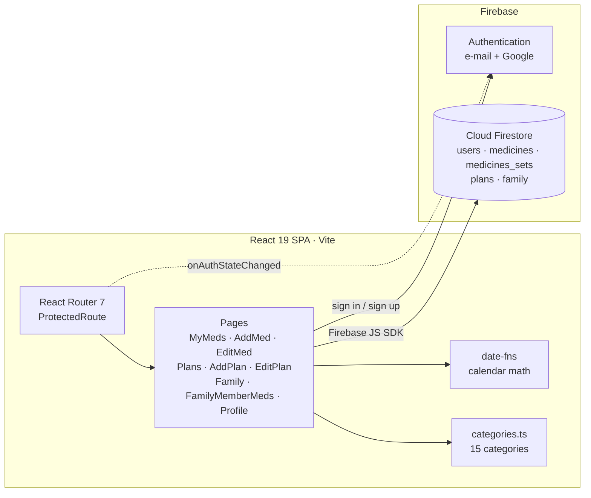
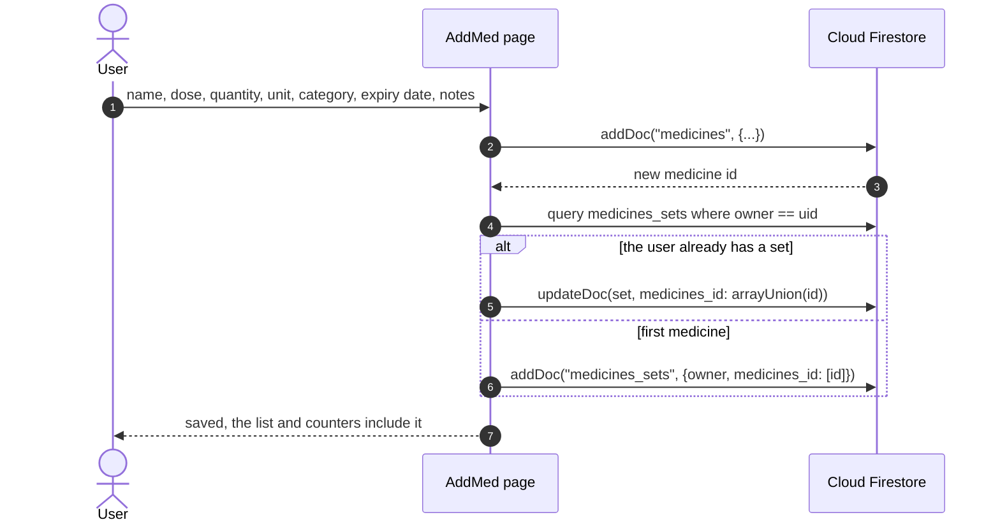
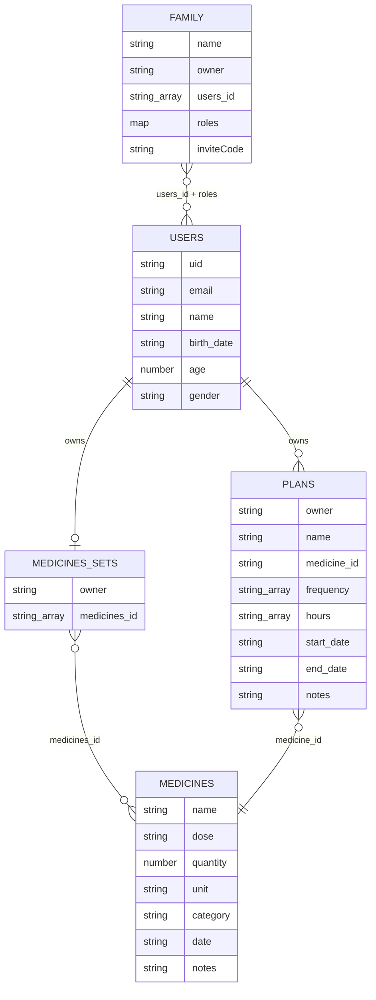

<p align="right">
  <a href="README.md"></a>
  <a href="README.pl.md"></a>
</p>

<a href="#see-it-in-action">
  <picture>
    <source media="(prefers-color-scheme: dark)" srcset="docs/banner-dark.svg" />
    <source media="(prefers-color-scheme: light)" srcset="docs/banner-light.svg" />
    
  </picture>
</a>

<p align="center">
  
  
  
  
  
  
  
</p>

<p align="center">
  <a href="#see-it-in-action"><b>Demo</b></a> &nbsp;·&nbsp;
  <a href="#highlights"><b>Highlights</b></a> &nbsp;·&nbsp;
  <a href="#screenshots"><b>Screenshots</b></a> &nbsp;·&nbsp;
  <a href="#how-it-works"><b>How it works</b></a> &nbsp;·&nbsp;
  <a href="#data-model"><b>Data model</b></a> &nbsp;·&nbsp;
  <a href="#getting-started"><b>Getting started</b></a>
</p>

> [!NOTE]
> **An organizer, not medical advice.** The app keeps track of what you have at home and when to take it. It does not check doses or drug interactions; always follow your doctor's or pharmacist's instructions.

**Domowa Apteczka** (*home medicine cabinet*) is a single-page web app for keeping the medicines at home under control. Add what you have with dose, quantity, category and expiry date; the dashboard tells you at a glance what is **still valid**, what **expires within 30 days** and what is **already expired**. Turn a prescription into a **treatment plan** (weekdays, hours, start and optional end date) and see every dose laid out on a monthly calendar.

Medicine cabinets are usually shared, so the app has **families**: create a group, invite people with a short code or by e-mail, give them a role (**owner**, **admin**, **member**, **viewer**) and look into each other's medicines. Everything runs in the browser on top of **Firebase Authentication** (e-mail + Google) and **Cloud Firestore**; there is no custom backend to host.

<p align="center"><b>Keywords</b></p>

<table align="center">
  <tr>
    <td align="right" valign="middle"><sub><b>Frontend</b></sub></td>
    <td>
      
      
      
      
      
      
    </td>
  </tr>
  <tr>
    <td align="right" valign="middle"><sub><b>Backend&nbsp;/&nbsp;BaaS</b></sub></td>
    <td>
      
      
      
      
    </td>
  </tr>
  <tr>
    <td align="right" valign="middle"><sub><b>Concepts</b></sub></td>
    <td>
      
      
      
      
      
    </td>
  </tr>
  <tr>
    <td align="right" valign="middle"><sub><b>Domain</b></sub></td>
    <td>
      
      
      
    </td>
  </tr>
  <tr>
    <td align="right" valign="middle"><sub><b>Tooling</b></sub></td>
    <td>
      
      
      
    </td>
  </tr>
</table>

## See it in action

<p align="center">
  
</p>

<p align="center"><sub>Login → expiry tiles as filters → quantity +/− → new medicine → treatment calendar → family roles → a member's medicines.</sub></p>

## Highlights

<table>
  <tr>
    <td width="33%" valign="top">
      <br />
      <b>Medicine inventory</b><br />
      <sub>Name, dose, quantity with unit (pcs / ml / mg), category, expiry date and notes. Quick <code>+</code> / <code>−</code> buttons update the stock straight from the list.</sub>
    </td>
    <td width="33%" valign="top">
      <br />
      <b>Expiry at a glance</b><br />
      <sub>Every card gets a badge: valid, <i>&lt; 30 days</i> or expired, with the exact number of days. Three counter tiles on top double as one-click filters.</sub>
    </td>
    <td width="33%" valign="top">
      <br />
      <b>Filter and sort</b><br />
      <sub>Filter by status and by 15 predefined categories (older free-text categories still show up); sort by expiry date, name, category or quantity, ascending or descending.</sub>
    </td>
  </tr>
  <tr>
    <td width="33%" valign="top">
      <br />
      <b>Treatment plans</b><br />
      <sub>Link a plan to a medicine, pick weekdays and any number of intake hours, set a start and an optional end. Open-ended plans simply keep repeating.</sub>
    </td>
    <td width="33%" valign="top">
      <br />
      <b>Families</b><br />
      <sub>Create a family, share a 6-character invite code (or add people by e-mail), rotate the code, rename or delete the group, leave it at any time.</sub>
    </td>
    <td width="33%" valign="top">
      <br />
      <b>Roles</b><br />
      <sub>Owner and admins manage members and can adjust their medicine stock; everyone else sees other members' medicines in read-only mode.</sub>
    </td>
  </tr>
  <tr>
    <td width="33%" valign="top">
      <br />
      <b>E-mail or Google</b><br />
      <sub>Firebase Authentication with e-mail + password or a Google account; protected routes send signed-out users back to the login page.</sub>
    </td>
    <td width="33%" valign="top">
      <br />
      <b>Profile</b><br />
      <sub>Edit name, date of birth (age is computed for you) and gender, or change the password without leaving the app.</sub>
    </td>
    <td width="33%" valign="top">
      <br />
      <b>No backend to run</b><br />
      <sub>A static React build talks directly to Firebase, so it can be hosted on any static hosting with an SPA fallback to <code>index.html</code> (e.g. Firebase Hosting, Netlify).</sub>
    </td>
  </tr>
</table>

## Screenshots

<p align="center">
  
</p>

<table>
  <tr>
    <td width="50%" valign="top">
      
      <p align="center"><b>What runs out soon?</b><br /><sub>Clicking a tile filters the list; badges show how many days are left.</sub></p>
    </td>
    <td width="50%" valign="top">
      
      <p align="center"><b>Add a medicine</b><br /><sub>Dose, quantity and unit, one of 15 categories, expiry date and notes.</sub></p>
    </td>
  </tr>
  <tr>
    <td width="50%" valign="top">
      
      <p align="center"><b>Create a treatment plan</b><br /><sub>Weekdays, any number of hours, start and optional end date.</sub></p>
    </td>
    <td width="50%" valign="top">
      
      <p align="center"><b>Family and roles</b><br /><sub>Invite code, roles per member and a shortcut to each member's medicines.</sub></p>
    </td>
  </tr>
</table>

<details>
<summary><b>More screens</b> (calendar, member's medicines, profile, editing, login)</summary>
<br />

| Treatment calendar | A family member's medicines |
|:---:|:---:|
|  |  |
| **Profile and password** | **Edit a medicine** |
|  |  |
| **Dashboard** | **Login (e-mail or Google)** |
|  |  |

</details>

<sub>Screenshots and the demo come from the real frontend with sample data (date fixed to 9 October 2026) served by an in-memory stand-in for Firebase, so they are reproducible.</sub>

## How it works

### Expiry status

<picture>
  <source media="(prefers-color-scheme: dark)" srcset="docs/expiry-dark.svg" />
  <source media="(prefers-color-scheme: light)" srcset="docs/expiry-light.svg" />
  
</picture>

The status is not stored anywhere. Each medicine keeps only its expiry date (`YYYY-MM-DD`); on every render the dashboard counts whole days from local midnight and puts the medicine into one of three buckets. The same function drives the badges, the three counter tiles and the status filter, so they can never disagree.

```ts
const d = daysUntil(med.date);          // date parsed as local midnight, no timezone shift
const status = d < 0 ? "expired" : d <= 30 ? "soon" : "ok";
```

### Treatment plans on a calendar

<picture>
  <source media="(prefers-color-scheme: dark)" srcset="docs/calendar-dark.svg" />
  <source media="(prefers-color-scheme: light)" srcset="docs/calendar-light.svg" />
  
</picture>

A plan stores **rules**, not individual doses: weekdays (`frequency`), intake times (`hours`), `start_date` and an optional `end_date`. The calendar walks the visible weeks (Monday first, including days from neighbouring months), keeps the days inside each plan's range whose weekday matches, adds one entry per hour and sorts each day by time. Clicking an entry opens the plan for editing.

### Families and roles

| Action | owner | admin | member | viewer |
|---|:---:|:---:|:---:|:---:|
| See other members' medicines | ✓ | ✓ | ✓ | ✓ |
| Change other members' quantities | ✓ | ✓ | | |
| Add members by e-mail, change roles, remove members | ✓ | ✓ | | |
| Rename the family, refresh the invite code | ✓ | ✓ | | |
| Delete the family | ✓ | | | |
| Join with a code, leave the family | ✓ | ✓ | ✓ | ✓ |

The creator becomes the owner and that role cannot be reassigned from the UI. People joining with a code start as `member`.

### Architecture



### Adding a medicine



## Data model



<details>
<summary><b>All collections and fields</b></summary>

#### `users/{uid}`

| Field | Type | Description |
|---|---|---|
| `uid` | string | Firebase Auth user id (also the document id) |
| `email` | string | E-mail, stored lowercase so members can be found by it |
| `name` | string | Display name |
| `birth_date` | string \| null | `YYYY-MM-DD` |
| `age` | number \| null | Computed from `birth_date` |
| `gender` | string | `male` / `female` / `other` |
| `createdAt` | timestamp | Registration time |

#### `medicines/{id}`

| Field | Type | Description |
|---|---|---|
| `name` | string | Medicine name |
| `dose` | string | Free text, e.g. `500 mg` |
| `quantity` | number | Current stock, never below 0 |
| `unit` | string | `pcs` / `ml` / `mg` |
| `category` | string | Category id, e.g. `pain`, `allergy` (see `src/constants/categories.ts`) |
| `date` | string | Expiry date `YYYY-MM-DD` |
| `notes` | string | Optional notes |

#### `medicines_sets/{id}`

| Field | Type | Description |
|---|---|---|
| `owner` | string | Owner's uid |
| `medicines_id` | string[] | Ids of the owner's medicines |
| `createdAt` | timestamp | Created on registration |

#### `plans/{id}`

| Field | Type | Description |
|---|---|---|
| `owner` | string | Owner's uid |
| `name` | string | Plan name |
| `medicine_id` | string | Linked medicine |
| `frequency` | string[] | Weekdays, e.g. `["monday", "thursday"]` |
| `hours` | string[] | Intake times `HH:MM` |
| `start_date` | string | `YYYY-MM-DD` |
| `end_date` | string | `YYYY-MM-DD`, empty string = open-ended |
| `notes` | string | Optional notes |

#### `family/{id}`

| Field | Type | Description |
|---|---|---|
| `name` | string | Family name |
| `owner` | string | Creator's uid |
| `users_id` | string[] | Member uids |
| `roles` | map uid → role | `owner` / `admin` / `member` / `viewer` |
| `inviteCode` | string | 6 characters, no look-alikes (`0/O`, `1/I`) |
| `createdAt`, `updatedAt` | timestamp | Server timestamps |

</details>

Medicines live in their own collection and a user's cabinet is a list of ids in `medicines_sets`. Reading another member's cabinet is therefore the same query with their uid, which is what the family view does.

## Tech Stack

| Layer | Technology |
|---|---|
| UI | React 19, TypeScript 5.9 |
| Routing | React Router 7 (`BrowserRouter`, protected routes) |
| Styling | Tailwind CSS 4 (`@tailwindcss/postcss`) with a few component classes (`btn`, `card`, status pills) |
| Build | Vite 7 (`rolldown-vite`), `@vitejs/plugin-react` |
| Dates | date-fns 4 |
| Auth | Firebase Authentication (e-mail + password, Google popup) |
| Database | Cloud Firestore (Firebase JS SDK 12) |
| Linting | ESLint 9, typescript-eslint, react-hooks, react-refresh |

## Project Structure

```
Domowa_Apteczka/
├── docs/                      # README assets: animated SVGs, demo.gif, hero.png, screenshots/, icons/
├── public/
│   └── firebase-messaging-sw.js
├── src/
│   ├── components/
│   │   ├── DashboardLayout.tsx    # sidebar, page title, sign-out
│   │   └── ProtectedRoute.tsx     # redirects signed-out users to "/"
│   ├── constants/
│   │   └── categories.ts          # 15 categories (id, Polish label, emoji)
│   ├── lib/
│   │   └── firebase.ts            # Firebase app, auth, db, Google provider
│   ├── pages/
│   │   ├── Login.tsx · Register.tsx
│   │   ├── MyMeds.tsx             # dashboard: tiles, filters, sorting, cards
│   │   ├── AddMed.tsx · EditMed.tsx
│   │   ├── Plans.tsx              # monthly calendar
│   │   ├── AddPlan.tsx · EditPlan.tsx
│   │   ├── Family.tsx             # families, roles, invite codes
│   │   ├── FamilyMemberMeds.tsx   # another member's medicines
│   │   └── Profile.tsx            # profile and password
│   ├── types.ts
│   ├── App.tsx                    # routes
│   ├── main.tsx
│   └── index.css                  # Tailwind + component classes
├── index.html
├── package.json
├── vite.config.ts
├── eslint.config.js
├── LICENSE
├── README.md                      # English
└── README.pl.md                   # Polski
```

## Getting Started

### Prerequisites

- **Node.js 20.19+** (or 22.12+) and npm, as required by Vite 7
- A **Firebase project** with Authentication and Cloud Firestore enabled

### Install and run

```bash
git clone https://github.com/Nurek54/Domowa_Apteczka.git
cd Domowa_Apteczka
npm install
npm run dev
# http://localhost:5173
```

### Use your own Firebase project

1. Create a project in the [Firebase Console](https://console.firebase.google.com/) and add a **Web app**.
2. **Authentication → Sign-in method**: enable **Email/Password** and **Google**. Under *Settings → Authorized domains* make sure `localhost` (and your hosting domain) is listed.
3. **Firestore Database**: create a database. The collections from [Data model](#data-model) are created automatically on first use.
4. Paste your web app config into `firebaseConfig` in [`src/lib/firebase.ts`](src/lib/firebase.ts).

> [!TIP]
> Firebase web config values are identifiers, not secrets; access is controlled by Firestore Security Rules. Before sharing a deployment, write rules that mirror the role table above (see [Limitations](#limitations)).

### Scripts

| Command | What it does |
|---|---|
| `npm run dev` | Dev server with hot reload |
| `npm run build` | Type-check (`tsc -b`) and production build to `dist/` |
| `npm run preview` | Serve the production build locally |
| `npm run lint` | ESLint |

## Limitations

- **Permissions are checked in the UI.** Roles decide which buttons are enabled; real protection needs Firestore Security Rules that enforce the same rules on the server.
- **Member and viewer currently have the same rights.** Both see other members' medicines read-only; `viewer` is ready for stricter rules.
- **No reminders yet.** `public/firebase-messaging-sw.js` is prepared for Firebase Cloud Messaging, but push notifications for doses are not wired up.
- **Polish UI.** Labels and category names are in Polish.

## License

Released under the [MIT License](LICENSE).

## Contact

**Grzegorz Sienkiewicz**
✉️ gsienkiewicz03@gmail.com
🐙 GitHub: [@Nurek54](https://github.com/Nurek54)
