<p align="right">
  <a href="README.md"></a>
  <a href="README.pl.md"></a>
</p>

<a href="#demo">
  <picture>
    <source media="(prefers-color-scheme: dark)" srcset="docs/banner-pl-dark.svg" />
    <source media="(prefers-color-scheme: light)" srcset="docs/banner-pl-light.svg" />
    
  </picture>
</a>

<p align="center">
  
  
  
  
  
  
  
</p>

<p align="center">
  <a href="#demo"><b>Demo</b></a> &nbsp;·&nbsp;
  <a href="#najważniejsze-funkcje"><b>Funkcje</b></a> &nbsp;·&nbsp;
  <a href="#zrzuty-ekranu"><b>Zrzuty ekranu</b></a> &nbsp;·&nbsp;
  <a href="#jak-to-działa"><b>Jak to działa</b></a> &nbsp;·&nbsp;
  <a href="#model-danych"><b>Model danych</b></a> &nbsp;·&nbsp;
  <a href="#uruchomienie"><b>Uruchomienie</b></a>
</p>

> [!NOTE]
> **Organizer, nie porada medyczna.** Aplikacja pilnuje, co masz w domu i kiedy to przyjąć. Nie sprawdza dawek ani interakcji leków; zawsze stosuj się do zaleceń lekarza lub farmaceuty.

**Domowa Apteczka** to aplikacja webowa (SPA), która pomaga zapanować nad lekami w domu. Dodajesz to, co masz, z dawką, ilością, kategorią i datą ważności, a panel od razu pokazuje, co jest **w terminie**, co **traci ważność w ciągu 30 dni** i co jest **już po terminie**. Zalecenie lekarza zamieniasz w **plan leczenia** (dni tygodnia, godziny, data startu i opcjonalnie końca) i widzisz każdą dawkę w kalendarzu miesięcznym.

Apteczka jest zwykle wspólna, dlatego aplikacja ma **rodziny**: tworzysz grupę, zapraszasz bliskich krótkim kodem albo po e-mailu, nadajesz role (**owner**, **admin**, **member**, **viewer**) i możecie zaglądać sobie nawzajem do leków. Wszystko działa w przeglądarce na **Firebase Authentication** (e-mail + Google) i **Cloud Firestore**; nie ma własnego backendu do utrzymywania.

<p align="center"><b>Słowa kluczowe</b></p>

<table align="center">
  <tr>
    <td align="right" valign="middle"><sub><b>Frontend</b></sub></td>
    <td>
      
      
      
      
      
      
    </td>
  </tr>
  <tr>
    <td align="right" valign="middle"><sub><b>Backend&nbsp;/&nbsp;BaaS</b></sub></td>
    <td>
      
      
      
      
    </td>
  </tr>
  <tr>
    <td align="right" valign="middle"><sub><b>Koncepcje</b></sub></td>
    <td>
      
      
      
      
      
    </td>
  </tr>
  <tr>
    <td align="right" valign="middle"><sub><b>Dziedzina</b></sub></td>
    <td>
      
      
      
    </td>
  </tr>
  <tr>
    <td align="right" valign="middle"><sub><b>Narzędzia</b></sub></td>
    <td>
      
      
      
    </td>
  </tr>
</table>

## Demo

<p align="center">
  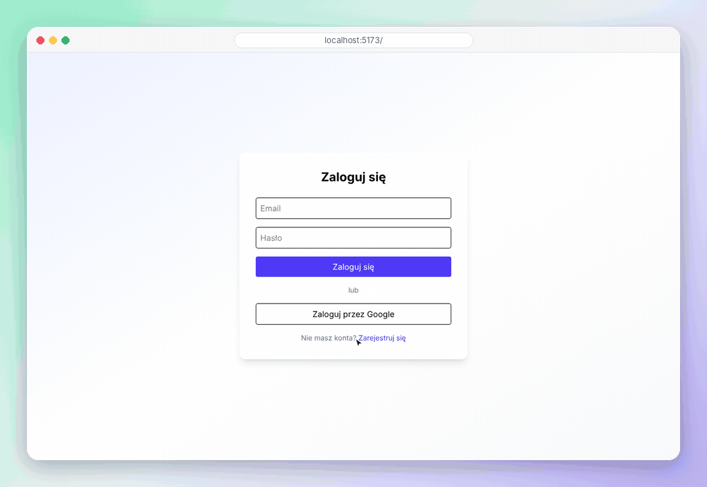
</p>

<p align="center"><sub>Logowanie → kafelki ważności jako filtry → ilość +/− → nowy lek → kalendarz planów → role w rodzinie → leki członka rodziny.</sub></p>

## Najważniejsze funkcje

<table>
  <tr>
    <td width="33%" valign="top">
      <br />
      <b>Ewidencja leków</b><br />
      <sub>Nazwa, dawka, ilość z jednostką (szt / ml / mg), kategoria, data ważności i uwagi. Przyciski <code>+</code> / <code>−</code> zmieniają stan prosto z listy.</sub>
    </td>
    <td width="33%" valign="top">
      <br />
      <b>Terminy na pierwszy rzut oka</b><br />
      <sub>Każda karta ma plakietkę: w terminie, <i>&lt; 30 dni</i> albo po terminie, z dokładną liczbą dni. Trzy kafelki z licznikami działają też jako filtry.</sub>
    </td>
    <td width="33%" valign="top">
      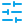<br />
      <b>Filtrowanie i sortowanie</b><br />
      <sub>Filtr po statusie i 15 predefiniowanych kategoriach (stare kategorie wpisane ręcznie też się pojawiają); sortowanie po dacie ważności, nazwie, kategorii lub ilości, rosnąco albo malejąco.</sub>
    </td>
  </tr>
  <tr>
    <td width="33%" valign="top">
      <br />
      <b>Plany leczenia</b><br />
      <sub>Plan powiązany z lekiem: dni tygodnia, dowolna liczba godzin przyjęcia, data startu i opcjonalnie końca. Plan bez daty końca po prostu się powtarza.</sub>
    </td>
    <td width="33%" valign="top">
      <br />
      <b>Rodziny</b><br />
      <sub>Tworzenie rodziny, 6-znakowy kod zaproszenia (albo dodanie po e-mailu), odświeżanie kodu, zmiana nazwy, usunięcie grupy i opuszczenie jej w każdej chwili.</sub>
    </td>
    <td width="33%" valign="top">
      <br />
      <b>Role</b><br />
      <sub>Owner i admini zarządzają członkami i mogą zmieniać stan ich leków; pozostali widzą leki innych członków w trybie tylko do odczytu.</sub>
    </td>
  </tr>
  <tr>
    <td width="33%" valign="top">
      <br />
      <b>E-mail lub Google</b><br />
      <sub>Firebase Authentication: e-mail + hasło albo konto Google; chronione ścieżki odsyłają niezalogowanych na stronę logowania.</sub>
    </td>
    <td width="33%" valign="top">
      <br />
      <b>Profil</b><br />
      <sub>Edycja imienia, daty urodzenia (wiek liczy się sam) i płci oraz zmiana hasła bez wychodzenia z aplikacji.</sub>
    </td>
    <td width="33%" valign="top">
      <br />
      <b>Bez własnego backendu</b><br />
      <sub>Statyczny build Reacta rozmawia bezpośrednio z Firebase, więc wystarczy dowolny hosting statyczny z przekierowaniem SPA na <code>index.html</code> (np. Firebase Hosting, Netlify).</sub>
    </td>
  </tr>
</table>

## Zrzuty ekranu

<p align="center">
  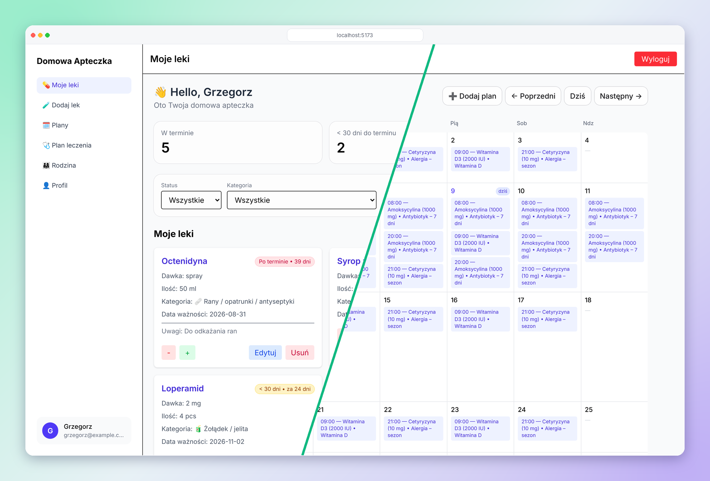
</p>

<table>
  <tr>
    <td width="50%" valign="top">
      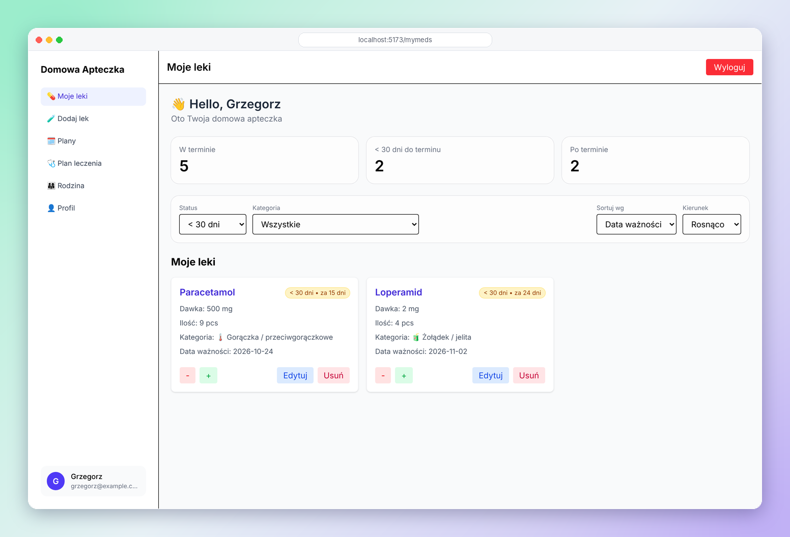
      <p align="center"><b>Co się zaraz przeterminuje?</b><br /><sub>Kliknięcie kafelka filtruje listę; plakietki pokazują, ile dni zostało.</sub></p>
    </td>
    <td width="50%" valign="top">
      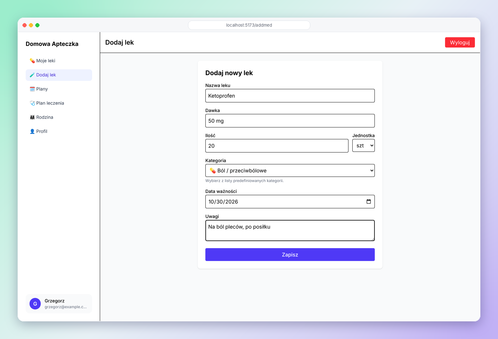
      <p align="center"><b>Dodawanie leku</b><br /><sub>Dawka, ilość i jednostka, jedna z 15 kategorii, data ważności i uwagi.</sub></p>
    </td>
  </tr>
  <tr>
    <td width="50%" valign="top">
      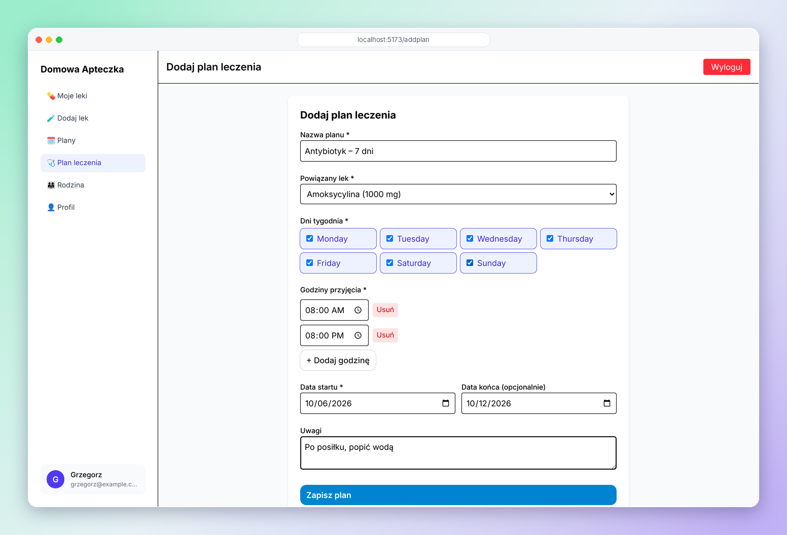
      <p align="center"><b>Nowy plan leczenia</b><br /><sub>Dni tygodnia, dowolna liczba godzin, start i opcjonalny koniec.</sub></p>
    </td>
    <td width="50%" valign="top">
      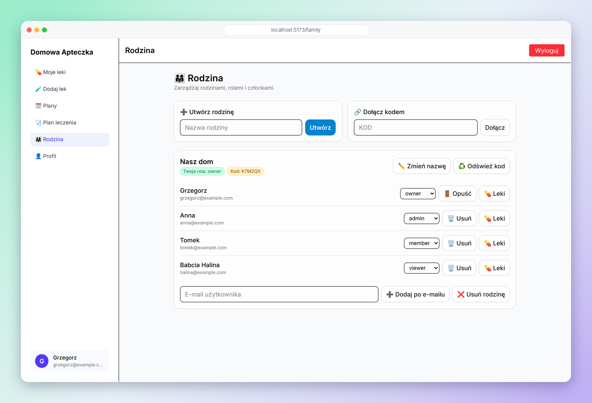
      <p align="center"><b>Rodzina i role</b><br /><sub>Kod zaproszenia, rola każdego członka i skrót do jego leków.</sub></p>
    </td>
  </tr>
</table>

<details>
<summary><b>Więcej ekranów</b> (kalendarz, leki członka rodziny, profil, edycja, logowanie)</summary>
<br />

| Kalendarz planów | Leki członka rodziny |
|:---:|:---:|
| 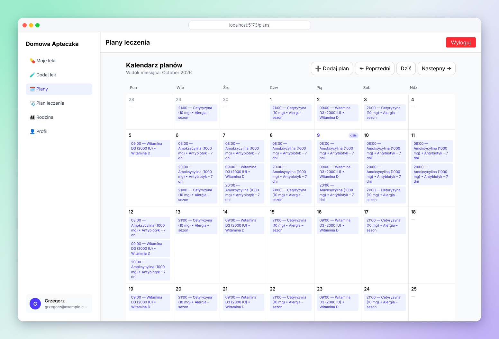 | 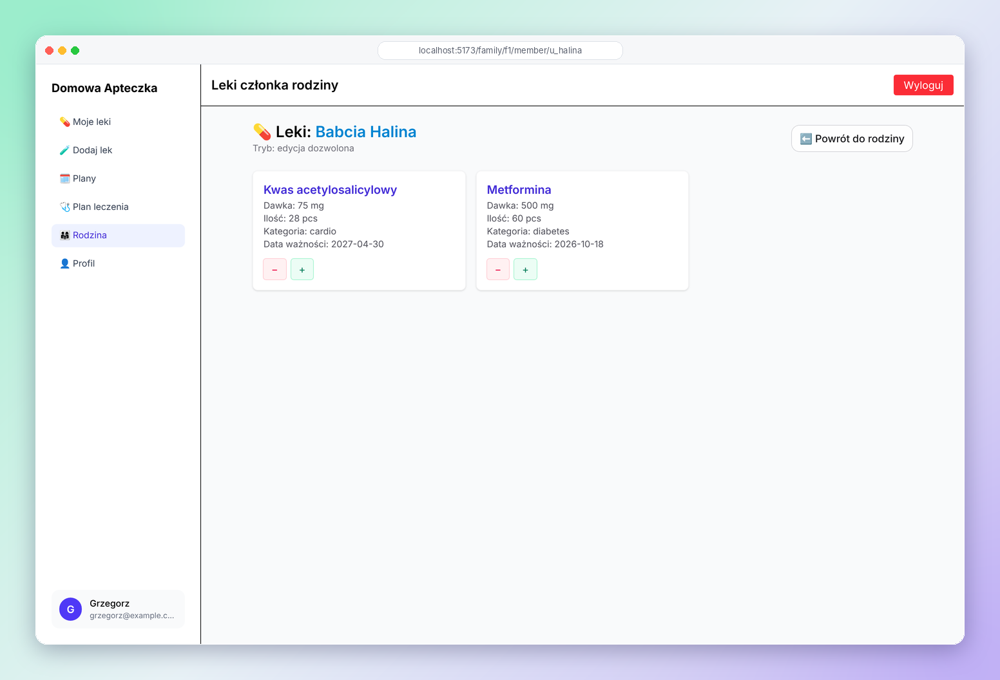 |
| **Profil i hasło** | **Edycja leku** |
| 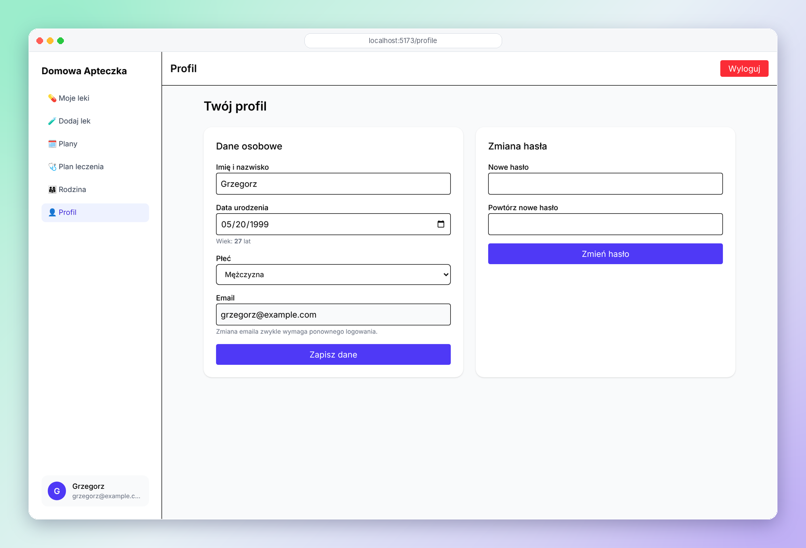 | 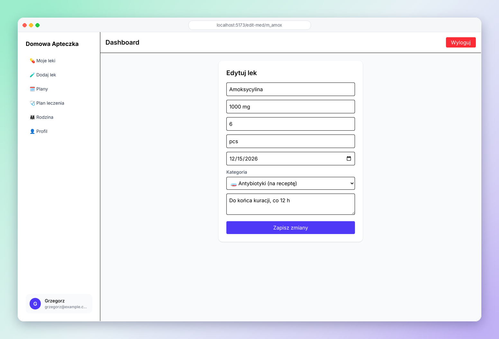 |
| **Panel główny** | **Logowanie (e-mail lub Google)** |
| 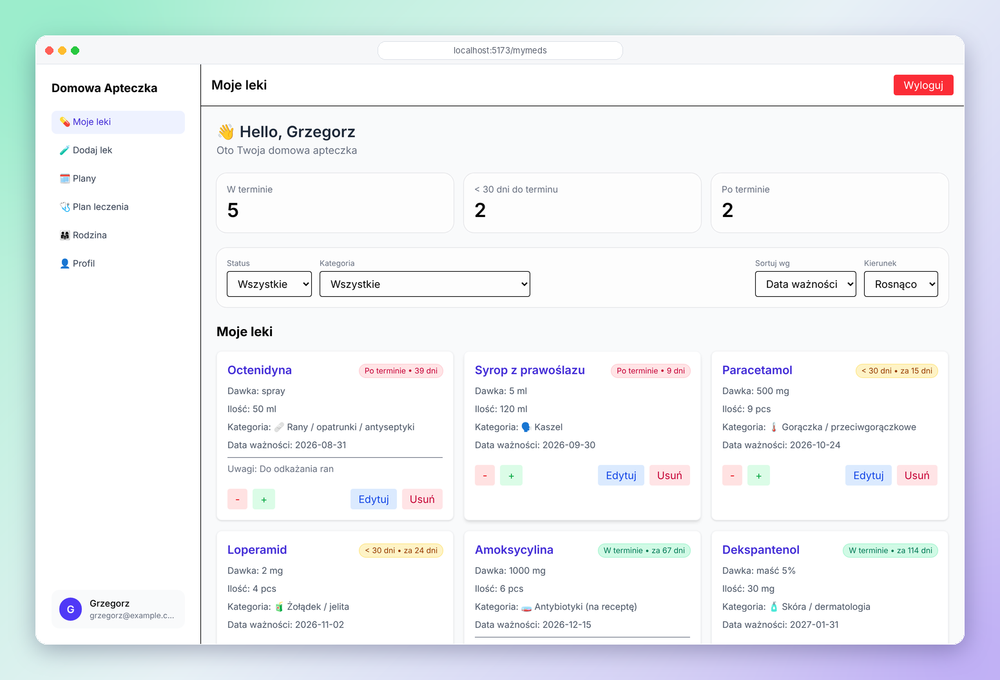 | 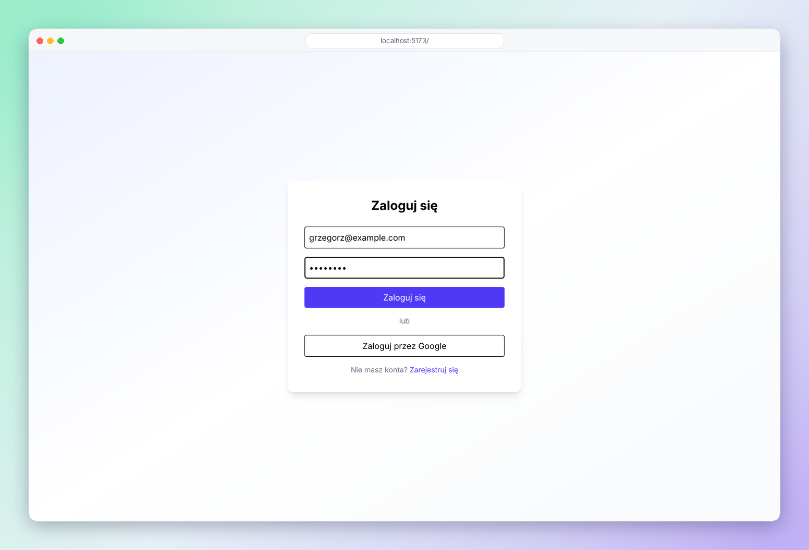 |

</details>

<sub>Zrzuty i demo pochodzą z prawdziwego frontendu z przykładowymi danymi (data ustawiona na 9 października 2026), które serwuje zastępcza, działająca w pamięci warstwa zamiast Firebase, dzięki czemu da się je odtworzyć.</sub>

## Jak to działa

### Status ważności

<picture>
  <source media="(prefers-color-scheme: dark)" srcset="docs/expiry-pl-dark.svg" />
  <source media="(prefers-color-scheme: light)" srcset="docs/expiry-pl-light.svg" />
  
</picture>

Status nie jest nigdzie zapisywany. Lek przechowuje tylko datę ważności (`YYYY-MM-DD`); przy każdym renderze panel liczy pełne dni od lokalnej północy i przypisuje lek do jednej z trzech grup. Ta sama funkcja steruje plakietkami, kafelkami z licznikami i filtrem statusu, więc nigdy się nie rozjadą.

```ts
const d = daysUntil(med.date);          // data liczona od lokalnej północy, bez przesunięć strefy
const status = d < 0 ? "expired" : d <= 30 ? "soon" : "ok";
```

### Plany leczenia w kalendarzu

<picture>
  <source media="(prefers-color-scheme: dark)" srcset="docs/calendar-pl-dark.svg" />
  <source media="(prefers-color-scheme: light)" srcset="docs/calendar-pl-light.svg" />
  
</picture>

Plan przechowuje **reguły**, a nie pojedyncze dawki: dni tygodnia (`frequency`), godziny (`hours`), `start_date` i opcjonalnie `end_date`. Kalendarz przechodzi po widocznych tygodniach (od poniedziałku, razem z dniami sąsiednich miesięcy), zostawia dni z zakresu planu o pasującym dniu tygodnia, dodaje wpis dla każdej godziny i sortuje dzień po czasie. Kliknięcie wpisu otwiera edycję planu.

### Rodziny i role

| Akcja | owner | admin | member | viewer |
|---|:---:|:---:|:---:|:---:|
| Podgląd leków innych członków | ✓ | ✓ | ✓ | ✓ |
| Zmiana ilości leków innych członków | ✓ | ✓ | | |
| Dodawanie po e-mailu, zmiana ról, usuwanie członków | ✓ | ✓ | | |
| Zmiana nazwy rodziny, odświeżenie kodu | ✓ | ✓ | | |
| Usunięcie rodziny | ✓ | | | |
| Dołączenie kodem, opuszczenie rodziny | ✓ | ✓ | ✓ | ✓ |

Twórca rodziny zostaje ownerem i tej roli nie da się przenieść z poziomu UI. Osoby dołączające kodem zaczynają jako `member`.

### Architektura

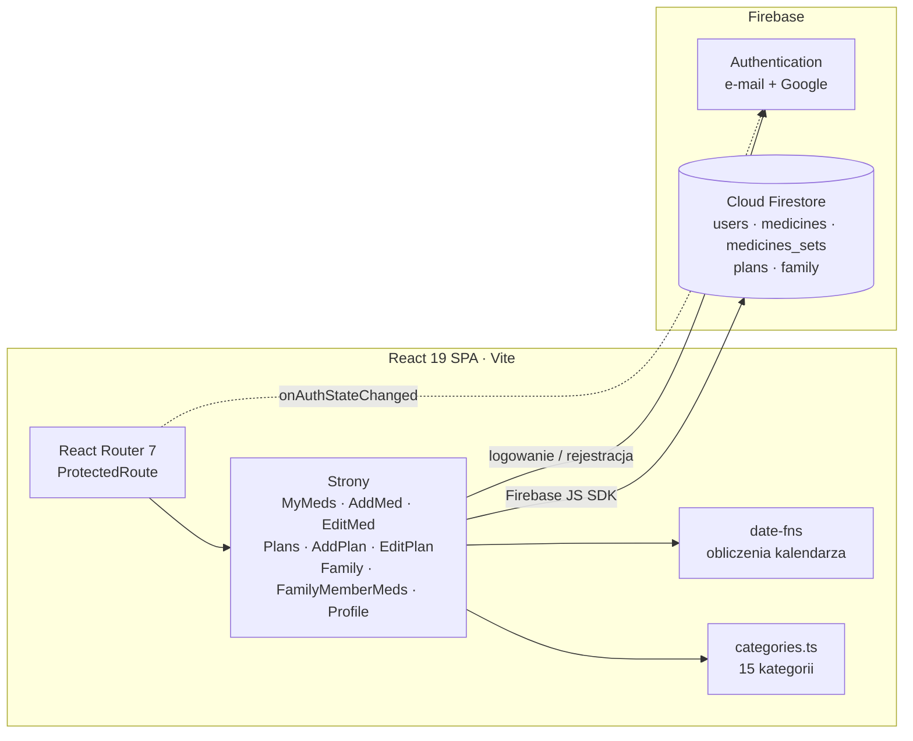

### Dodanie leku

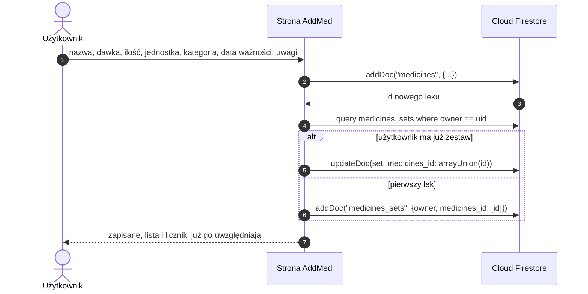

## Model danych

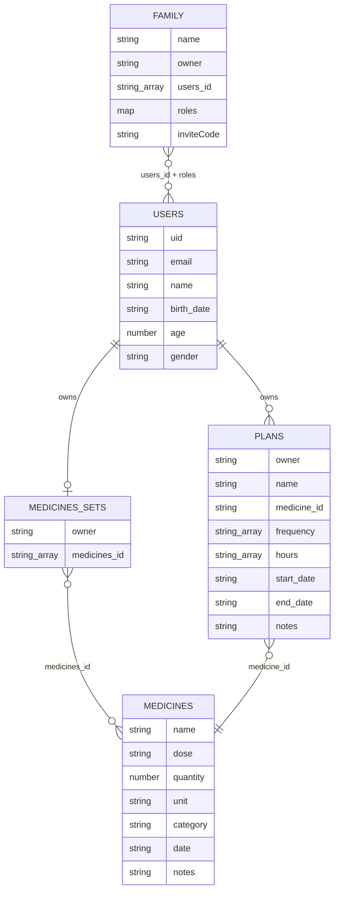

<details>
<summary><b>Wszystkie kolekcje i pola</b></summary>

#### `users/{uid}`

| Pole | Typ | Opis |
|---|---|---|
| `uid` | string | ID użytkownika Firebase Auth (też ID dokumentu) |
| `email` | string | E-mail zapisany małymi literami, żeby dało się po nim znaleźć członka |
| `name` | string | Wyświetlana nazwa |
| `birth_date` | string \| null | `YYYY-MM-DD` |
| `age` | number \| null | Wyliczany z `birth_date` |
| `gender` | string | `male` / `female` / `other` |
| `createdAt` | timestamp | Data rejestracji |

#### `medicines/{id}`

| Pole | Typ | Opis |
|---|---|---|
| `name` | string | Nazwa leku |
| `dose` | string | Dowolny tekst, np. `500 mg` |
| `quantity` | number | Aktualny stan, nigdy poniżej 0 |
| `unit` | string | `pcs` / `ml` / `mg` |
| `category` | string | ID kategorii, np. `pain`, `allergy` (zob. `src/constants/categories.ts`) |
| `date` | string | Data ważności `YYYY-MM-DD` |
| `notes` | string | Opcjonalne uwagi |

#### `medicines_sets/{id}`

| Pole | Typ | Opis |
|---|---|---|
| `owner` | string | UID właściciela |
| `medicines_id` | string[] | ID leków właściciela |
| `createdAt` | timestamp | Tworzony przy rejestracji |

#### `plans/{id}`

| Pole | Typ | Opis |
|---|---|---|
| `owner` | string | UID właściciela |
| `name` | string | Nazwa planu |
| `medicine_id` | string | Powiązany lek |
| `frequency` | string[] | Dni tygodnia, np. `["monday", "thursday"]` |
| `hours` | string[] | Godziny przyjęcia `HH:MM` |
| `start_date` | string | `YYYY-MM-DD` |
| `end_date` | string | `YYYY-MM-DD`, pusty napis = plan bez końca |
| `notes` | string | Opcjonalne uwagi |

#### `family/{id}`

| Pole | Typ | Opis |
|---|---|---|
| `name` | string | Nazwa rodziny |
| `owner` | string | UID twórcy |
| `users_id` | string[] | UID członków |
| `roles` | mapa uid → rola | `owner` / `admin` / `member` / `viewer` |
| `inviteCode` | string | 6 znaków, bez mylących par (`0/O`, `1/I`) |
| `createdAt`, `updatedAt` | timestamp | Znaczniki czasu serwera |

</details>

Leki leżą we własnej kolekcji, a apteczka użytkownika to lista ID w `medicines_sets`. Podgląd apteczki innego członka to więc to samo zapytanie z jego UID, i dokładnie tak działa widok rodziny.

## Stos technologiczny

| Warstwa | Technologia |
|---|---|
| UI | React 19, TypeScript 5.9 |
| Routing | React Router 7 (`BrowserRouter`, chronione ścieżki) |
| Style | Tailwind CSS 4 (`@tailwindcss/postcss`) plus kilka klas komponentów (`btn`, `card`, plakietki statusu) |
| Build | Vite 7 (`rolldown-vite`), `@vitejs/plugin-react` |
| Daty | date-fns 4 |
| Logowanie | Firebase Authentication (e-mail + hasło, popup Google) |
| Baza danych | Cloud Firestore (Firebase JS SDK 12) |
| Linting | ESLint 9, typescript-eslint, react-hooks, react-refresh |

## Struktura projektu

```
Domowa_Apteczka/
├── docs/                      # grafiki do README: animowane SVG, demo.gif, hero.png, screenshots/, icons/
├── public/
│   └── firebase-messaging-sw.js
├── src/
│   ├── components/
│   │   ├── DashboardLayout.tsx    # sidebar, tytuł strony, wylogowanie
│   │   └── ProtectedRoute.tsx     # przekierowuje niezalogowanych na "/"
│   ├── constants/
│   │   └── categories.ts          # 15 kategorii (id, etykieta PL, emoji)
│   ├── lib/
│   │   └── firebase.ts            # aplikacja Firebase, auth, db, provider Google
│   ├── pages/
│   │   ├── Login.tsx · Register.tsx
│   │   ├── MyMeds.tsx             # panel: kafelki, filtry, sortowanie, karty
│   │   ├── AddMed.tsx · EditMed.tsx
│   │   ├── Plans.tsx              # kalendarz miesięczny
│   │   ├── AddPlan.tsx · EditPlan.tsx
│   │   ├── Family.tsx             # rodziny, role, kody zaproszeń
│   │   ├── FamilyMemberMeds.tsx   # leki innego członka
│   │   └── Profile.tsx            # profil i hasło
│   ├── types.ts
│   ├── App.tsx                    # routing
│   ├── main.tsx
│   └── index.css                  # Tailwind + klasy komponentów
├── index.html
├── package.json
├── vite.config.ts
├── eslint.config.js
├── LICENSE
├── README.md                      # English
└── README.pl.md                   # Polski
```

## Uruchomienie

### Wymagania

- **Node.js 20.19+** (lub 22.12+) i npm, tego wymaga Vite 7
- **Projekt Firebase** z włączonym Authentication i Cloud Firestore

### Instalacja i start

```bash
git clone https://github.com/Nurek54/Domowa_Apteczka.git
cd Domowa_Apteczka
npm install
npm run dev
# http://localhost:5173
```

### Własny projekt Firebase

1. Utwórz projekt w [Firebase Console](https://console.firebase.google.com/) i dodaj **aplikację Web**.
2. **Authentication → Sign-in method**: włącz **Email/Password** i **Google**. W *Settings → Authorized domains* sprawdź, czy jest `localhost` (i domena hostingu).
3. **Firestore Database**: utwórz bazę. Kolekcje z sekcji [Model danych](#model-danych) powstaną same przy pierwszym użyciu.
4. Wklej konfigurację aplikacji Web do `firebaseConfig` w [`src/lib/firebase.ts`](src/lib/firebase.ts).

> [!TIP]
> Wartości konfiguracji Firebase dla aplikacji Web to identyfikatory, a nie sekrety; dostęp kontrolują reguły bezpieczeństwa Firestore. Zanim udostępnisz wdrożenie, napisz reguły odpowiadające tabeli ról powyżej (zob. [Ograniczenia](#ograniczenia)).

### Skrypty

| Komenda | Co robi |
|---|---|
| `npm run dev` | Serwer deweloperski z hot reload |
| `npm run build` | Sprawdzenie typów (`tsc -b`) i build produkcyjny do `dist/` |
| `npm run preview` | Lokalny podgląd buildu produkcyjnego |
| `npm run lint` | ESLint |

## Ograniczenia

- **Uprawnienia są sprawdzane w UI.** Role decydują, które przyciski są aktywne; prawdziwa ochrona wymaga reguł Firestore Security Rules, które wymuszą to samo po stronie serwera.
- **Member i viewer mają na razie te same prawa.** Obaj widzą leki innych członków tylko do odczytu; `viewer` jest przygotowany pod ostrzejsze reguły.
- **Brak przypomnień.** `public/firebase-messaging-sw.js` jest przygotowany pod Firebase Cloud Messaging, ale powiadomienia o dawkach nie są jeszcze podpięte.
- **Interfejs po polsku.** Etykiety i nazwy kategorii są w języku polskim.

## Licencja

Projekt udostępniony na [licencji MIT](LICENSE).

## Kontakt

**Grzegorz Sienkiewicz**
✉️ gsienkiewicz03@gmail.com
🐙 GitHub: [@Nurek54](https://github.com/Nurek54)
